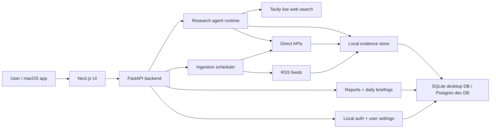
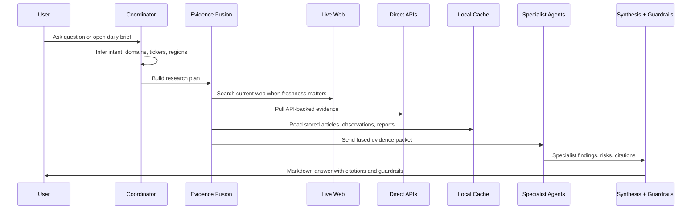

# VerityDesk

VerityDesk is a local-first AI intelligence desk for daily news, markets, companies, macroeconomics, and housing research. It combines live web research, direct data APIs, scheduled ingestion, multi-agent analysis, source-backed citations, personalization, and a packaged macOS desktop app.

The project is designed to answer questions like:

- What are the major world, U.S., AI, and market events I should know today?
- What changed for my watchlist and the S&P 500?
- What is happening in a specific housing market?
- Which sources support this answer, and what is uncertain?

> VerityDesk is for research and educational use only. It is not financial advice and does not provide buy, sell, or hold recommendations.

## What Makes It Interesting

- **Agentic research workflow:** a coordinator routes work to specialist agents, fuses evidence, and creates a final cited answer.
- **Tavily-first live web research:** current web search is the primary path for flexible questions, while direct APIs and local data verify and add structure.
- **Direct API ingestion:** FRED, Census, SEC, FHFA, Freddie Mac, Alpha Vantage, Finnhub, NewsAPI, BBC RSS, and GDELT are integrated or scaffolded.
- **Personalized daily intelligence:** user settings drive daily briefing topics, watchlists, regions, housing markets, companies, and answer style.
- **Local desktop deployment:** Electron packages the Next.js frontend, FastAPI backend, local database mode, app icon, and startup process into `VerityDesk.app`.
- **Source-backed output:** answers include confidence, citations, timestamps, data gaps, and guardrails for investment-oriented content.

## High-Level Architecture



## Agent Workflow



## Core Agents

| Agent | Role |
| --- | --- |
| `CoordinatorAgent` | Determines intent, routes to specialists, and controls the research workflow. |
| `NewsDigestAgent` | Summarizes broad world, policy, market, AI, banking, labor, and legal news. |
| `CompanyAgent` | Analyzes company news, filings, risks, catalysts, and ticker-specific context. |
| `MarketAgent` | Interprets markets, rates, credit, sectors, commodities, and risk signals. |
| `MacroAgent` | Tracks macroeconomic, policy, inflation, jobs, rates, and consumer conditions. |
| `HousingAgent` | Focuses on housing, mortgage rates, affordability, local markets, and inventory signals. |
| `SynthesisAgent` | Turns specialist findings into a clear natural-language answer. |
| `RiskGuardrailAgent` | Prevents direct financial advice and enforces disclaimer/risk language. |

## Data Sources And APIs

| Source | Used For | Key Required |
| --- | --- | --- |
| Tavily | Live web research and current cited sources | Yes |
| OpenAI | Natural-language synthesis and specialist agent summaries | Yes |
| FRED | Rates, labor, macro, mortgage-rate series | Yes |
| U.S. Census | Economic indicators, housing/economic datasets | Yes |
| Alpha Vantage | Market news, quotes, macro/sector context | Yes |
| Finnhub | Company news and quote snapshots | Yes |
| NewsAPI | Broad news discovery by category/topic | Yes |
| SEC APIs / EDGAR RSS | Company filings and reporting signals | No |
| BBC RSS | Reputable world and business news feed | No |
| FHFA HPI | House price index observations | No |
| Freddie Mac PMMS | Mortgage-rate dataset | No |
| GDELT | Global event/news discovery | No |

## Application Features

- Login and local user-specific settings.
- First-time setup flow for location, watchlist, companies, sectors, briefing topics, and answer style.
- Daily brief page with score, summary cards, deeper read, citations, and data gaps.
- Agent chat with session memory and previous chat list.
- Visual home dashboard for daily read, housing, markets, companies, and macro modules.
- Source health/status page and manual refresh.
- Saved report history.
- Local desktop database storage.
- Development Postgres support.
- Packaged macOS app build.

## Tech Stack

| Layer | Technology |
| --- | --- |
| Frontend | Next.js, React, TypeScript, Tailwind CSS |
| Backend | FastAPI, Python, SQLAlchemy, Alembic |
| Agents | Python agent runtime, OpenAI model client, Tavily live web research |
| Storage | SQLite for packaged desktop, Postgres for dev/multiuser path |
| Ingestion | RSS, official APIs, dataset downloads, scheduled refresh |
| Desktop | Electron, electron-builder, macOS `.app` packaging |
| Tooling | Makefile, Docker Compose for Postgres/dev |

## Desktop App

The local macOS app is generated at:

```text
desktop/dist/mac-arm64/VerityDesk.app
```

It starts the backend and frontend automatically, reads local API keys, runs migrations, and stores data locally.

Desktop data lives at:

```text
~/Library/Application Support/VerityDesk/
```

Important files:

```text
~/Library/Application Support/VerityDesk/config.env
~/Library/Application Support/VerityDesk/veritydesk.db
```

## Quickstart: Desktop Build

From the repo root:

```bash
make node-install
python3 -m venv .venv
.venv/bin/pip install -e backend[dev]
cd frontend && npm install
cd ../desktop && npm install
cd ..
make desktop-pack-mac
```

Then open:

```text
desktop/dist/mac-arm64/VerityDesk.app
```

The app is currently unsigned, so macOS may require right-click `Open` or a System Settings approval.

## Quickstart: Local Development

Create the environment:

```bash
cp .env.example .env
python3 -m venv .venv
.venv/bin/pip install -e backend[dev]
make node-install
cd frontend && npm install
cd ../desktop && npm install
cd ..
```

Run the local web app:

```bash
make postgres-up
make db-upgrade
make app-dev
```

URLs:

- Frontend: `http://localhost:3000`
- Backend: `http://localhost:8000`
- Health: `http://localhost:8000/health`

## Configuration

Development uses `.env`.

Packaged desktop mode uses:

```text
~/Library/Application Support/VerityDesk/config.env
```

Common keys:

```bash
OPENAI_API_KEY=
TAVILY_API_KEY=
FRED_API_KEY=
CENSUS_API_KEY=
ALPHA_VANTAGE_API_KEY=
FINNHUB_API_KEY=
NEWSAPI_KEY=
```

Do not commit real keys.

## Database

Development can use Postgres:

```bash
make postgres-up
make postgres-shell
```

The packaged desktop app uses SQLite:

```text
~/Library/Application Support/VerityDesk/veritydesk.db
```

You can inspect it in DBeaver with a SQLite connection.

## Safety And Guardrails

VerityDesk avoids direct investment instructions. Strategy-oriented responses must include:

- research/education framing
- no buy/sell/hold recommendation
- risks and uncertainty
- citations where available
- source freshness and data gaps

## Project Status

Completed:

- Research and planning
- Next.js + FastAPI app scaffold
- Database models and migrations
- Source catalog and ingestion
- Multi-agent research framework
- Report and daily briefing generation
- Tavily live web research
- Major UI redesign and personalization
- Multiuser-local auth and user-scoped reports
- Local macOS desktop app packaging

Current branch focus:

- Documentation polish for interview/repo review.

## Documentation Map

- [Architecture](docs/architecture/README.md)
- [Agent framework](docs/agents/README.md)
- [Data sources and APIs](docs/data-sources/README.md)
- [Desktop user guide](docs/deployment/desktop-user-guide.md)
- [Desktop deployment details](docs/deployment/desktop-deployment.md)
- [Postgres multiuser local setup](docs/deployment/postgres-multiuser-local.md)
- [Implementation phases](docs/roadmap/implementation-phases.md)
- [Phase 10 desktop deployment](docs/phases/phase-10/README.md)

Planned documentation in this branch:

- `docs/database/`

## Future Work

- Apple Developer ID signing and notarization.
- `.dmg` installer.
- Smaller app bundle.
- macOS Keychain-backed API key storage.
- More robust frontend smoke tests.
- Portfolio-aware research mode.
- Alerts, widgets, notifications, and report export.
- Hosted/cloud deployment path for multi-device sync.
