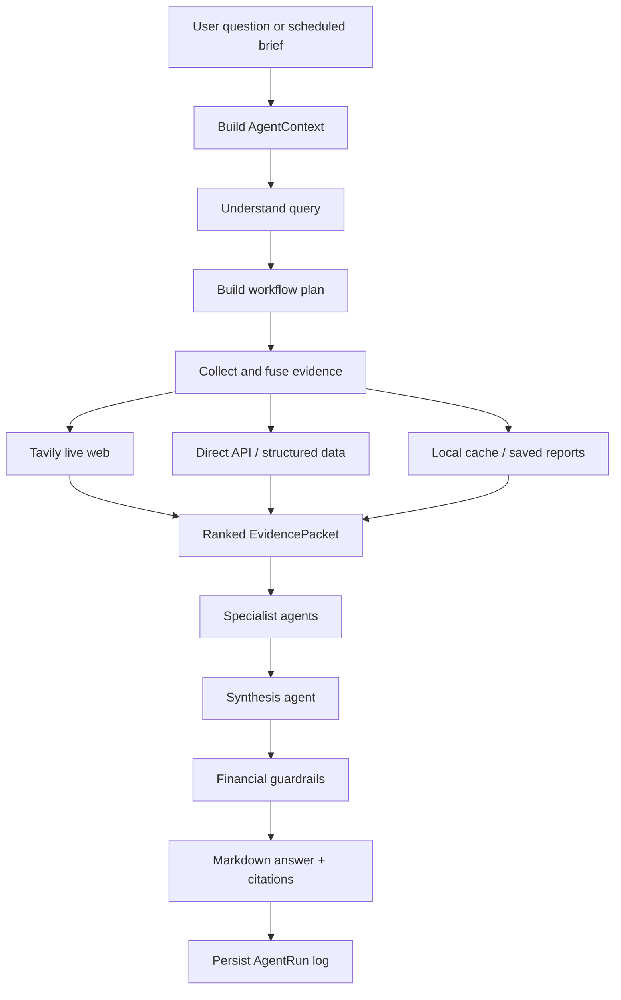
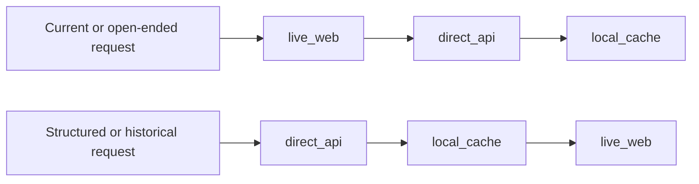
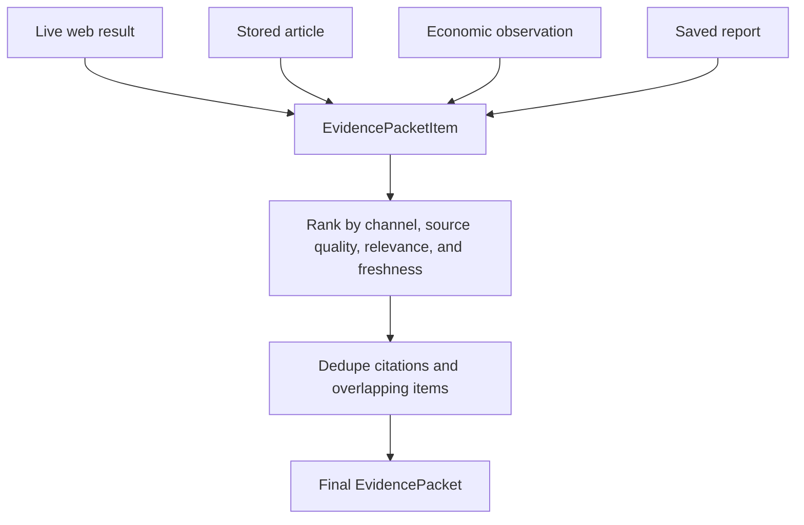

# Agent Framework

VerityDesk uses a deterministic multi-agent research workflow. The goal is not to let every agent wander independently; the system first understands the user request, builds one evidence packet, and then gives each specialist the same source-backed context.

This keeps answers current, cited, and easier to audit.

## Runtime Flow

## Core Files

| File | Responsibility |
| --- | --- |
| `backend/app/services/agent_runtime.py` | Agent registry, runtime execution, request context, and run logging. |
| `backend/app/services/research_workflow.py` | Query understanding, routing, domain inference, source selection, and workflow plan creation. |
| `backend/app/services/evidence_fusion.py` | Live web, API, local cache, and saved-report evidence collection. Ranks and dedupes evidence. |
| `backend/app/agents/domain_agents.py` | Specialist domain agents and their expected domains, sources, and series. |
| `backend/app/agents/model_client.py` | OpenAI model calls and template fallback behavior. |
| `backend/app/services/guardrails.py` | Financial-advice wording checks and disclaimer enforcement. |
| `backend/app/api/v1/agents.py` | HTTP endpoints for chat, runs, and live web research. |

## Specialist Agents

| Agent | Focus | Primary Evidence |
| --- | --- | --- |
| `NewsDigestAgent` | Broad world, U.S. policy, market, technology, banking, labor, and legal news. | Tavily, BBC RSS, NewsAPI, GDELT, Alpha Vantage. |
| `CompanyAgent` | Company news, ticker context, filings, catalysts, and risks. | Tavily, SEC APIs, EDGAR RSS, Finnhub, Alpha Vantage, NewsAPI. |
| `MarketAgent` | Markets, rates, credit, sectors, commodities, and risk signals. | Tavily, FRED, Freddie Mac PMMS, Alpha Vantage, Finnhub, NewsAPI. |
| `MacroAgent` | Macro policy, inflation, labor, rates, consumer, and credit conditions. | Tavily, FRED, Census, Alpha Vantage. |
| `HousingAgent` | Housing, mortgage rates, affordability, local markets, inventory, and construction. | Tavily, FHFA HPI, Freddie Mac PMMS, FRED, Census, NewsAPI. |
| `SynthesisAgent` | Combines specialist output into the final answer. | Specialist findings and shared evidence packet. |
| `RiskGuardrailAgent` | Keeps investment content framed as research, not instructions. | Final answer text and guardrail policy. |

## Query Understanding

Before specialists run, VerityDesk builds a structured interpretation of the request:

- inferred intent
- topics such as housing, markets, macro, company, world news, technology, energy, or banking
- domains such as `Housing and Real Estate`, `Markets and Rates`, or `Technology and AI`
- tickers and company names
- regions and local-market hints
- freshness requirements
- answer style
- retrieval priority

The system favors live web research when the request is current, broad, local, or open-ended. Examples include questions with words like `today`, `latest`, `current`, `right now`, `this week`, `news`, or `what is happening`.

## Retrieval Priority

`live_web` is the primary route for flexible questions because the user expects current information and broad coverage.

`direct_api` is used to verify and quantify the answer with official or provider-backed data.

`local_cache` reuses already ingested articles, economic observations, saved reports, and source health.

## Evidence Packet

All retrieval channels are normalized into an `EvidencePacket`.

Evidence items can come from:

- `live_web`: Tavily current web results.
- `direct_api`: structured or licensed provider-backed data.
- `local_cache`: stored articles and economic observations.
- `saved_report`: previously generated reports and briefings.

The packet carries citations, retrieval statuses, source kinds, publisher names, timestamps, summaries, and metadata. Specialists receive the packet instead of independently rebuilding evidence from scratch.

## Agent Output

Each specialist returns:

- summary
- claims
- citations
- confidence
- risks
- follow-up questions

The final synthesis response is expected to be clear Markdown with:

- a short bottom line
- specific events or data points
- trend interpretation
- uncertainty and gaps
- citations hidden or shown by the UI
- financial disclaimer language when relevant

## Guardrails

VerityDesk can discuss investing context, risks, scenarios, and signals, but it should not tell the user to buy, sell, or hold a security.

Investment-adjacent answers must preserve:

- research and education framing
- no direct recommendation wording
- risks and uncertainty
- citations and freshness notes
- reminders to do independent research or consult a licensed professional

## Observability

Agent runs are stored in `agent_runs`, including:

- request id
- agent name
- input context
- output payload
- status
- error, if any
- started and completed timestamps

The UI can show recent runs so failures and routing behavior are visible during development and debugging.

## Current Limitations

- The system uses deterministic routing, not a full autonomous planning loop.
- Tavily searches cost API credits, so query batching and smarter search budgeting remain future improvements.
- Some source adapters are stronger than others; source health exists so incomplete or failing adapters are visible.
- Final answer quality depends on the OpenAI key, Tavily key, source availability, and the freshness of scheduled ingestion.

## Future Improvements

- Smarter Tavily budgeting so simple questions do not use several searches.
- More granular user preferences for which agents should run by default.
- Better long-term memory across chats, reports, and recurring interests.
- Deeper visual summaries from structured API data.
- More explicit source reliability scoring in the final answer.
