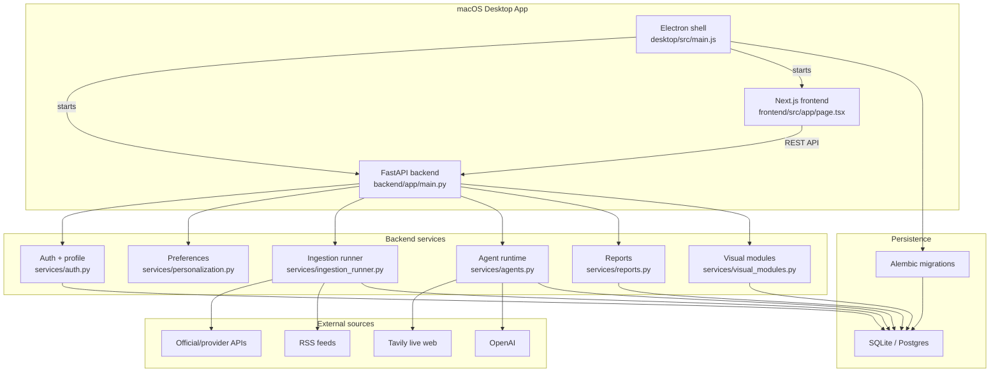
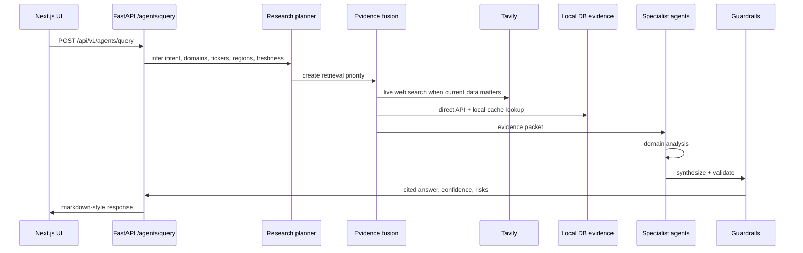
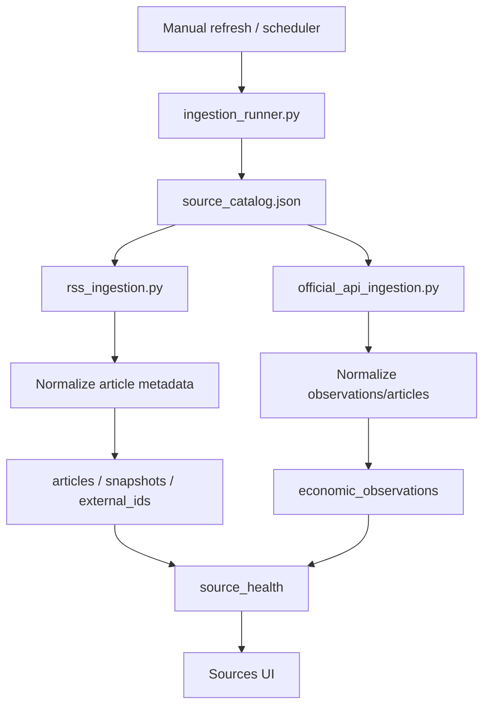
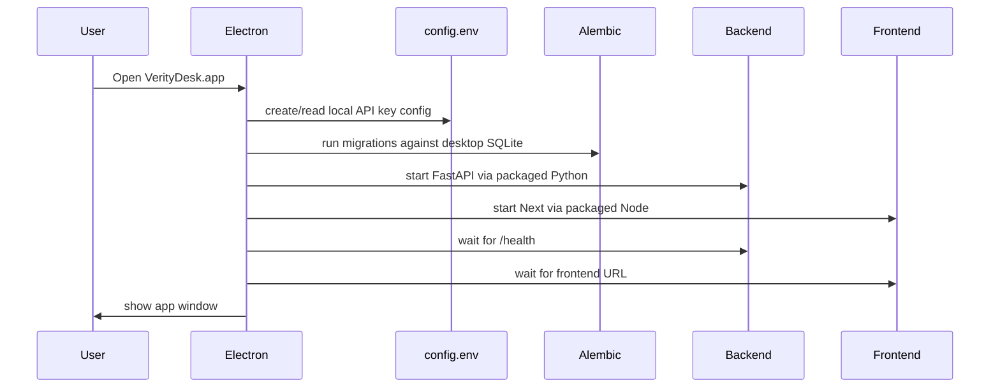

# Architecture

VerityDesk is a local-first desktop intelligence app built from three cooperating runtimes:

- **Electron desktop shell** starts and supervises the packaged app.
- **Next.js frontend** renders the user experience.
- **FastAPI backend** handles auth, ingestion, agents, reports, settings, and persistence.

The system supports two database modes:

- **Packaged desktop:** SQLite at `~/Library/Application Support/VerityDesk/veritydesk.db`.
- **Development:** Postgres through Docker/Postgres.app, or any `DATABASE_URL` supported by SQLAlchemy.

## System Overview

## Request / Research Flow

User research questions go through the agent pipeline:

Important modules:

- `backend/app/services/research_workflow.py`: query understanding and retrieval plan.
- `backend/app/services/evidence_fusion.py`: live web, direct API, local cache, and saved report evidence packet.
- `backend/app/services/agents.py`: orchestration, routing, synthesis, and guardrails.
- `backend/app/agents/domain_agents.py`: domain-specialist agent implementations.
- `backend/app/agents/model_client.py`: OpenAI model abstraction with template fallback.

## Daily Briefing Flow

Daily briefings are report objects generated from user preferences, current evidence, and agent output.

```mermaid
flowchart LR
    Schedule["Daily scheduler<br/>or manual button"] --> Ingest["Run ingestion"]
    Ingest --> Health["Update source health"]
    Health --> Prefs["Read user preferences"]
    Prefs --> Brief["Generate daily briefing"]
    Brief --> Agents["News, Market, Macro, Housing, Company agents"]
    Agents --> Synthesis["Synthesis + guardrails"]
    Synthesis --> Report["Save report"]
    Report --> UI["Daily Brief UI"]
```

Relevant modules:

- `backend/app/services/scheduler.py`
- `backend/app/services/ingestion_runner.py`
- `backend/app/services/reports.py`
- `backend/app/services/suggestions.py`
- `frontend/src/app/page.tsx`

## Ingestion Flow

Ingestion normalizes RSS/API/dataset data into source-aware local records.

Core tables:

- `sources`
- `articles`
- `economic_observations`
- `ingestion_runs`
- `source_health`
- `retrieved_snapshots`
- `external_ids`

## Desktop Startup Flow

The packaged desktop app starts both the backend and the frontend.

Relevant files:

- `desktop/src/main.js`
- `desktop/package.json`
- `desktop/scripts/generate_app_icon.py`
- `docs/deployment/desktop-user-guide.md`

## API Surface

FastAPI route groups:

| Route group | Purpose |
| --- | --- |
| `/health`, `/version` | System health/version checks. |
| `/auth/*` | Register, login, logout, profile update, current user. |
| `/preferences` | User-specific saved intelligence preferences. |
| `/agents/query` | Agentic research response. |
| `/agents/live-web/search` | Direct live web search endpoint. |
| `/agents/runs` | Agent run history. |
| `/ingestion/*` | Manual refresh, source health, latest items, scheduler config. |
| `/reports/*` | Daily briefings and research reports. |
| `/sources` | Source catalog. |
| `/suggestions/proactive` | Suggested research prompts/actions. |
| `/visuals/modules` | Home visual module data. |
| `/watchlist/*` | Watch items and alerts foundation. |

## Database Model Groups

| Group | Tables |
| --- | --- |
| Source catalog and evidence | `sources`, `articles`, `economic_observations`, `retrieved_snapshots`, `external_ids` |
| Ingestion health | `ingestion_runs`, `source_health` |
| Reports and citations | `reports`, `citations` |
| Users and sessions | `users`, `user_sessions`, `user_settings` |
| Watch items | `watch_items`, `watch_alerts` |
| Agent observability | `agent_runs` |

## Runtime Modes

| Mode | Command | Database | Notes |
| --- | --- | --- | --- |
| Local web dev | `make app-dev` | `.env` `DATABASE_URL` | Starts backend and frontend in dev mode. |
| Postgres dev | `make postgres-up` | Postgres on local Docker | Useful for DBeaver and multiuser-style testing. |
| Desktop prod-like | `make desktop-prod` | Desktop SQLite path | Uses built frontend and Electron shell. |
| Packaged app | `make desktop-pack-mac` | Desktop SQLite path | Produces `desktop/dist/mac-arm64/VerityDesk.app`. |

## Design Decisions

- **Local-first:** user data and settings can live on the Mac without a hosted backend.
- **Web-first research:** live Tavily search is preferred for current questions, while local/API evidence adds structure and verification.
- **Evidence packets:** specialist agents receive a unified evidence object instead of independently searching everything.
- **User-scoped reports:** reports and visuals are filtered by authenticated user.
- **Guardrail layer:** investment-oriented output is educational and risk-framed, not advice.
- **Desktop shell over rewrite:** Electron wraps the existing Next.js + FastAPI app instead of rewriting the product as a native app.

