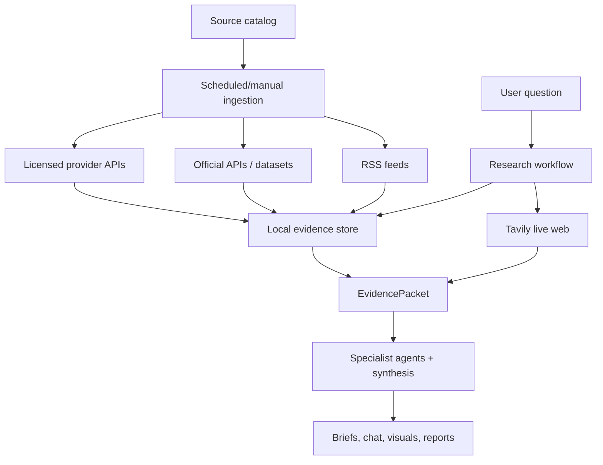

# Data Sources And APIs

VerityDesk uses two complementary evidence paths:

- live web research for current, flexible questions
- direct source ingestion for structured, repeatable data

The product goal is that users can ask broad questions naturally while the app still grounds answers in credible sources, timestamps, citations, and structured observations.

## Source Flow



## Source Types

| Type | Role |
| --- | --- |
| Live web | Searches the current web for flexible questions and current events. |
| Official API | Primary-source structured data from government or regulatory systems. |
| Official RSS | Official or reputable feed metadata used for headline discovery and citations. |
| Official dataset | Downloaded public datasets for housing, rates, and time-series observations. |
| Licensed API | Free-key or plan-limited data providers used for market/company/news coverage. |
| Public discovery API | Broad discovery source, useful for leads but not treated as the final authority alone. |

## Configured Sources

| Source ID | Source | Type | What It Powers | Key Required |
| --- | --- | --- | --- | --- |
| `tavily` | Tavily Live Web | Live web | Current web research, flexible Q&A, source-backed answers. | Yes |
| `bbc-news-rss` | BBC News RSS | Official RSS | World, geopolitics, U.S. economy/policy, company headlines. | No |
| `sec-data-apis` | SEC Data APIs | Official API | Company submissions and regulatory/company facts. | No |
| `sec-edgar-rss` | SEC EDGAR RSS | Official RSS | Filing alerts and filing metadata. | No |
| `fred-api` | FRED API | Official API | Fed funds, unemployment, mortgage rates, macro/rate series. | Yes |
| `census-economic-indicators` | U.S. Census Economic Indicators | Official API | Housing construction, residential sales, retail indicators. | Yes |
| `fhfa-hpi` | FHFA House Price Index | Official dataset | U.S., Census-region, state, and metro house price index data. | No |
| `freddie-mac-pmms` | Freddie Mac PMMS | Official dataset | National 30-year and 15-year mortgage-rate averages. | No |
| `company-investor-relations` | Company Investor Relations Pages | Official webpage | Future official company press releases, shareholder letters, events, and presentations. | No |
| `alpha-vantage` | Alpha Vantage | Licensed API | Market news sentiment, top movers, global quote snapshots, sector context. | Yes |
| `finnhub` | Finnhub | Licensed API | Company news and quote snapshots for configured symbols. | Yes |
| `newsapi` | NewsAPI | Licensed API | Broad news discovery and U.S. top-headline metadata. | Yes |
| `gdelt-cloud` | GDELT Cloud | Public API | Broad global event/news discovery. | No |

## API Keys

Development reads keys from `.env`.

Packaged desktop mode reads keys from:

```text
~/Library/Application Support/VerityDesk/config.env
```

Common keys:

```bash
OPENAI_API_KEY=
TAVILY_API_KEY=
FRED_API_KEY=
CENSUS_API_KEY=
ALPHA_VANTAGE_API_KEY=
FINNHUB_API_KEY=
NEWSAPI_KEY=
```

`OPENAI_API_KEY` powers model synthesis. It is not a data source by itself.

`TAVILY_API_KEY` powers live web research and is the main source path for open-ended current questions.

Do not commit real API keys.

## Ingestion Behavior

Sources are refreshed by the ingestion runner through manual refresh or the daily scheduler. Ingested data is normalized into:

- source records
- article metadata and excerpts
- economic observations
- source health rows
- ingestion run history

The UI uses this stored data for:

- source status
- home dashboard visual modules
- daily briefing context
- agent chat evidence
- saved reports

## Live Web Behavior

Tavily is used when VerityDesk needs current context or a flexible answer. Examples:

- `What is happening in Arizona housing right now?`
- `What are the biggest AI stories today?`
- `What changed for Nvidia this week?`
- `Where is the S&P 500 right now?`

The research workflow still combines Tavily with API/local data when available. Tavily helps discover current sources; APIs and cached observations help quantify and verify.

## Structured Data Behavior

Structured source data is most useful for repeatable observations and charts.

Examples:

- FRED: `FEDFUNDS`, `MORTGAGE30US`, `UNRATE`
- Census: manufacturing, housing starts, residential sales, retail indicators
- FHFA: house price indexes by U.S., region, state, and metro
- Freddie Mac PMMS: national weekly mortgage rates
- Alpha Vantage and Finnhub: quote snapshots and market/company metadata

## Source Quality

VerityDesk assigns evidence quality based on source type:

| Quality | Examples | Intended Use |
| --- | --- | --- |
| Primary | FRED, Census, FHFA, SEC | Strongest source for official numbers and filings. |
| Provider | Alpha Vantage, Finnhub, Freddie Mac, NewsAPI, GDELT | Useful provider-backed data or discovery. |
| Reputable | BBC RSS, SEC EDGAR RSS | Credible article/feed metadata and citations. |
| Internal | Saved reports and local derived state | Useful context, but not an external authority. |
| Discovery | Broad search/discovery results | Useful leads that should be verified when possible. |

## Storage Policy

The source catalog tracks whether each source allows full-text storage and redistribution.

VerityDesk generally stores:

- metadata
- source URLs
- timestamps
- short excerpts or summaries
- structured values

It avoids storing or redistributing full article bodies unless the source permits it.

## Current Limitations

- Some sources are plan-limited or rate-limited, especially free-key providers.
- `company-investor-relations` is cataloged as an official source path, but individual company page parsers still need future expansion.
- Freddie Mac PMMS is national; it does not provide state or metro mortgage rates.
- GDELT is useful for broad discovery but should not be treated as the final authority on its own.
- Tavily searches consume credits, so future work should reduce unnecessary duplicate searches.

## Future Source Improvements

- Add more company investor-relations parsers.
- Expand Census datasets and improve labels.
- Add more housing inventory/rent sources.
- Add smarter Tavily search budgeting.
- Add source reliability explanations directly in the UI.
- Add optional portfolio/brokerage integrations only after clear user permission and security design.
