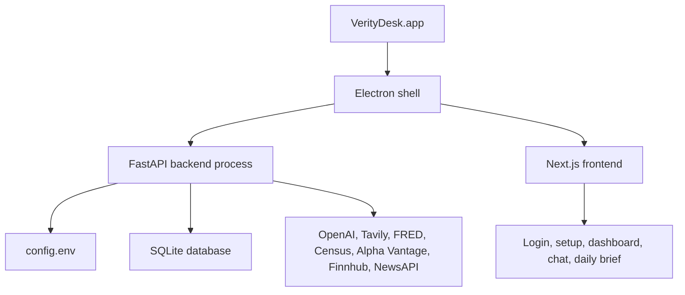

# Deployment

VerityDesk's first deployment target is a local macOS desktop app. The app packages the web UI, backend service, local database mode, app icon, and startup orchestration into a clickable `VerityDesk.app`.

## Deployment Shape



## Local macOS App

The packaged app is generated at:

```text
desktop/dist/mac-arm64/VerityDesk.app
```

The desktop app:

- starts backend and frontend services automatically
- reads local API keys from Application Support
- stores local user data in SQLite
- runs database migrations on startup
- does not require Docker Desktop or Postgres for normal use
- can be pinned to the Dock after opening

## Local Data Paths

```text
~/Library/Application Support/VerityDesk/config.env
~/Library/Application Support/VerityDesk/veritydesk.db
```

`config.env` contains local API keys.

`veritydesk.db` contains accounts, settings, reports, source data, and app state.

Neither file should be committed to GitHub.

## Build Commands

| Command | Purpose |
| --- | --- |
| `make desktop-check` | Syntax-check Electron main/preload scripts. |
| `make desktop-build` | Build the frontend and run desktop checks. |
| `make desktop-prod` | Run Electron against the production frontend server. |
| `make desktop-pack-mac` | Build the local unsigned macOS `.app`. |
| `make desktop-dist-mac` | Build a distributable macOS artifact path through electron-builder. |

## Development Versus Desktop

| Concern | Development | Packaged Desktop |
| --- | --- | --- |
| UI | `http://localhost:3000` | Electron window |
| Backend | `http://localhost:8000` | App-managed backend process |
| Database | Postgres or SQLite based on `.env` | SQLite in Application Support |
| Keys | Repo-local `.env` | Application Support `config.env` |
| Docker | Optional for Postgres | Not required |

## Current Distribution Status

The app works as a local unsigned macOS app. It is not yet signed, notarized, or packaged as a polished `.dmg` installer.

For personal/local usage, open the generated `.app` directly. If macOS blocks it, use right-click `Open` or approve it through System Settings.

## Future Deployment Work

- Apple Developer ID signing.
- Notarization.
- `.dmg` installer.
- Auto-update strategy.
- Smaller runtime bundle.
- macOS Keychain-backed API key storage.
- Hosted/cloud deployment path for account sync across devices.

## Related Docs

- [Desktop User Guide](desktop-user-guide.md)
- [Desktop Deployment Details](desktop-deployment.md)
- [Postgres Multiuser Local Setup](postgres-multiuser-local.md)
- [Database And Persistence](../database/README.md)
