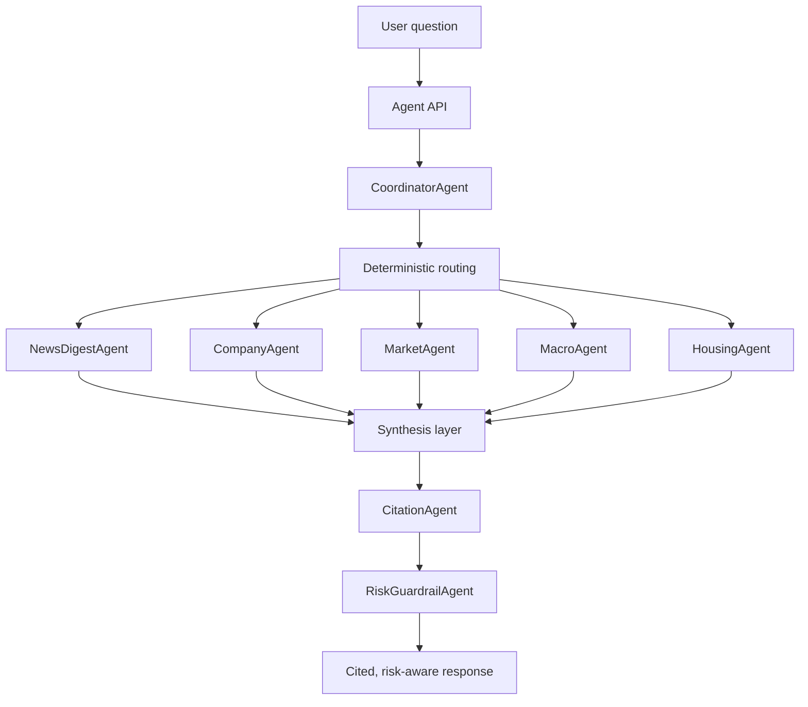
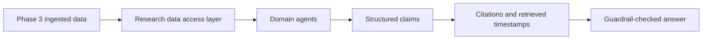

# Phase 4

Status: In progress

Phase 4 adds the multi-agent research system on top of the Phase 3 ingestion foundation. The goal is to turn collected source data into structured, cited, guardrail-safe research responses.

## Architecture Flow

## Data Flow

## Completed Milestones

- [Milestone 4.1: Agent Runtime Foundation](milestones/4.1-agent-runtime-foundation.md)

## Planned Milestones

- [Milestone 4.2: Research Data Access Layer](milestones/4.2-research-data-access-layer.md)
- [Milestone 4.3: Domain Agent Implementations](milestones/4.3-domain-agent-implementations.md)
- [Milestone 4.4: Coordinator Routing And Synthesis](milestones/4.4-coordinator-routing-and-synthesis.md)
- [Milestone 4.5: Citations And Guardrails](milestones/4.5-citations-and-guardrails.md)
- [Milestone 4.6: Agent API And UI Integration](milestones/4.6-agent-api-and-ui-integration.md)
- [Milestone 4.7: Phase 4 Validation And Docs](milestones/4.7-phase-4-validation-and-docs.md)

## Phase 4 Scope

- Agent runtime contracts.
- Agent run logging.
- Query routing by intent, domain, ticker, company, and region.
- Domain-specific agents for news, companies, markets, macro, and housing.
- Citation-aware synthesis.
- Investment-output guardrails and disclaimers.
- Frontend visibility for real agent runs.

## Not In Scope

- Full report generation.
- Source expansion beyond the Phase 3 connectors.
- True automatic daily background ingestion.
- Desktop app packaging.

Those are covered by later phases.
