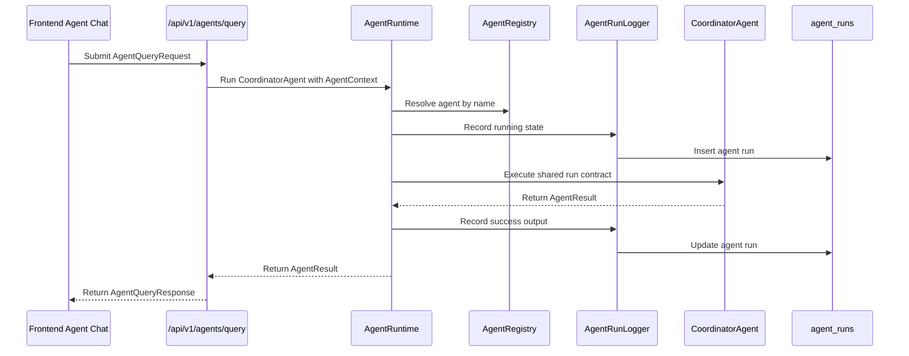
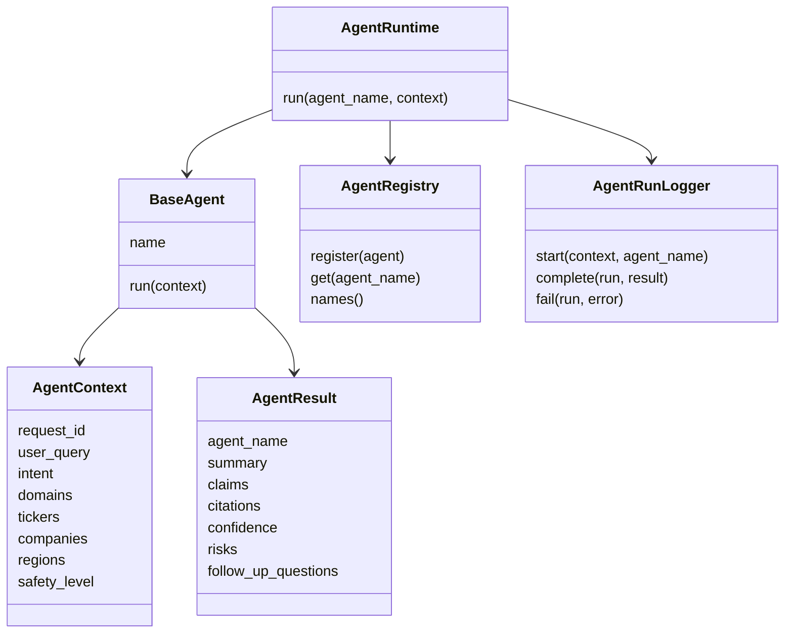

# Milestone 4.1: Agent Runtime Foundation

Status: Complete

## Goal

Create the shared runtime foundation that all research agents will use.

## Runtime Flow

## Runtime Components

## Deliverables

- Agent request and response schemas.
- Shared agent context object.
- Agent result object with confidence, risks, citations, and follow-up questions.
- Base agent interface.
- Agent registry.
- Agent run logging service foundation.
- Tests for schema validation and base runtime behavior.

## Implemented

- Added `AgentContext` and `AgentResult` schemas.
- Added `BaseAgent` runtime protocol.
- Added `AgentRegistry` for deterministic agent registration and lookup.
- Added `AgentRuntime` for invoking registered agents through a shared contract.
- Added `AgentRunLogger` for recording running, success, and failed agent runs using the existing `agent_runs` table.
- Updated the placeholder coordinator to run through the runtime foundation.
- Updated the agent query endpoint to provide a database session for run logging.
- Added tests for context construction, registry behavior, runtime success logging, and runtime failure logging.

## Definition Of Done

- Agents can be registered and invoked through a shared runtime contract.
- Agent outputs have a consistent shape.
- Runtime tests pass.

## Validation Results

- Backend tests passed: 54 passed.
- Backend lint passed.

## Next Milestone

- Milestone 4.2: Research Data Access Layer.
