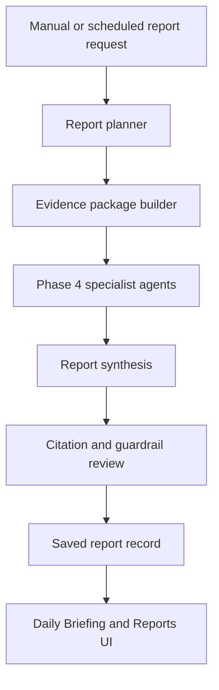

# Phase 5

Status: In Progress

Phase 5 turns the Phase 3 ingestion foundation and Phase 4 agent framework into durable research outputs: daily briefings, company reports, market strategy notes, housing/macro reports, saved report history, and clearer evidence presentation.

## Architecture Flow

## Completed Milestones

- [Milestone 5.1: Report Data Model And API Contracts](milestones/5.1-report-data-model-and-api-contracts.md)
- [Milestone 5.2: Evidence Cleanup And Source Data Quality](milestones/5.2-evidence-cleanup-and-source-data-quality.md)
- [Milestone 5.3: Daily Briefing Generator](milestones/5.3-daily-briefing-generator.md)
- [Milestone 5.4: Company Research Report Generator](milestones/5.4-company-research-report-generator.md)

## Planned Milestones

- [Milestone 5.5: Market Strategy And Scenario Reports](milestones/5.5-market-strategy-and-scenario-reports.md)
- [Milestone 5.6: Housing And Macro Reports](milestones/5.6-housing-and-macro-reports.md)
- [Milestone 5.7: Report Persistence And Citation Panels](milestones/5.7-report-persistence-and-citation-panels.md)
- [Milestone 5.8: Proactive Briefing Suggestions](milestones/5.8-proactive-briefing-suggestions.md)
- [Milestone 5.9: Scheduler Hardening And Automatic Report Runs](milestones/5.9-scheduler-hardening-and-automatic-report-runs.md)
- [Milestone 5.10: Phase 5 Validation And Docs](milestones/5.10-phase-5-validation-and-docs.md)

## Phase 5 Scope

- Generate source-backed reports from ingested data and agent outputs.
- Persist generated reports and citation metadata.
- Improve economic observation labels and grouping.
- Add proactive daily context and suggested follow-up questions.
- Harden scheduler settings for automatic local report generation.

## Not In Scope

- Full dashboard redesign.
- Native desktop packaging.
- Multi-user/cloud deployment.

Those are covered by later phases.

Next phase:

- Phase 6: Full UI Dashboard.
