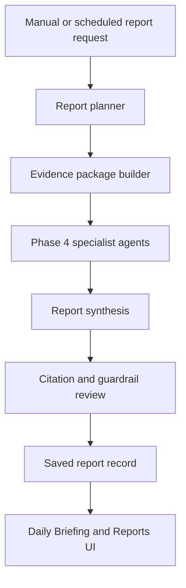

# Phase 5

Status: Complete

Phase 5 turns the Phase 3 ingestion foundation and Phase 4 agent framework into durable research outputs: daily briefings, company reports, market strategy notes, housing/macro reports, saved report history, and clearer evidence presentation.

## Architecture Flow

## Completed Milestones

- [Milestone 5.1: Report Data Model And API Contracts](milestones/5.1-report-data-model-and-api-contracts.md)
- [Milestone 5.2: Evidence Cleanup And Source Data Quality](milestones/5.2-evidence-cleanup-and-source-data-quality.md)
- [Milestone 5.3: Daily Briefing Generator](milestones/5.3-daily-briefing-generator.md)
- [Milestone 5.4: Company Research Report Generator](milestones/5.4-company-research-report-generator.md)
- [Milestone 5.5: Market Strategy And Scenario Reports](milestones/5.5-market-strategy-and-scenario-reports.md)
- [Milestone 5.6: Housing And Macro Reports](milestones/5.6-housing-and-macro-reports.md)
- [Milestone 5.7: Report Persistence And Citation Panels](milestones/5.7-report-persistence-and-citation-panels.md)
- [Milestone 5.8: Proactive Briefing Suggestions](milestones/5.8-proactive-briefing-suggestions.md)
- [Milestone 5.9: Scheduler Hardening And Automatic Report Runs](milestones/5.9-scheduler-hardening-and-automatic-report-runs.md)
- [Milestone 5.10: Phase 5 Validation And Docs](milestones/5.10-phase-5-validation-and-docs.md)

## Planned Milestones

None.

## Phase 5 Scope

- Generate source-backed reports from ingested data and agent outputs.
- Persist generated reports and citation metadata.
- Improve economic observation labels and grouping.
- Add proactive daily context and suggested follow-up questions.
- Harden scheduler settings for automatic local report generation.

## Not In Scope

- Full dashboard redesign.
- Native desktop packaging.
- Multi-user/cloud deployment.

Those are covered by later phases.

Next phase:

- Phase 6: Simpler UI And Personalization.

## Local Phase 5 Workflows

- Generate reports from Dashboard, Daily Briefing, Watchlist, or Reports.
- Review saved reports in the Reports tab after restarting the app.
- Inspect citation source, URL, published/released date, retrieved date, and support text from each report detail.
- Enable daily automation in Settings. The backend checks the saved local schedule while `make app-dev` or `make backend-dev` is running.
- Turn on automatic daily briefing generation in Settings when the daily workflow should create a saved briefing after ingestion.

## Validation Summary

- Backend tests pass.
- Backend lint passes.
- Frontend typecheck passes.
- Frontend production build passes.
- Migration upgrade to latest schema passes through the backend test suite.

## Known Handoffs

- Phase 6 should polish the dashboard and split dense report surfaces into dedicated user-friendly views.
- Phase 6 should add editable watchlist and preference management instead of relying on defaults.
- Phase 6 should reduce manual controls so the normal path is one natural-language question instead of dropdowns plus separate ticker fields.
- Phase 6 should hide operational detail from the main screen and make source/API status understandable in plain language.
- Phase 7 should finish scaffolded API connectors and parser-needed source work before desktop packaging.
- Phase 7 should improve regional data support for questions such as mortgage rates in Arizona.
- Phase 8 should make the agent workflow more flexible, including local-data-first retrieval and approved live/source lookup when local evidence is missing.
- Later phases should package the local app as a native macOS desktop app and improve portable deployment.

Detailed next-phase plans:

- [Phase 6: Simpler UI And Personalization](../phase-6/README.md)
- [Phase 7: Source Expansion And Parser Completion](../phase-7/README.md)
- [Phase 8: Agent Automation And Flexible Retrieval](../phase-8/README.md)
