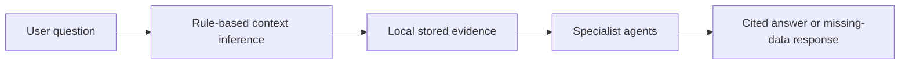
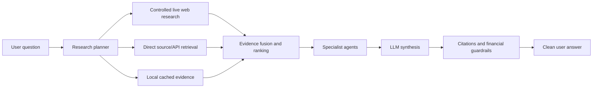

# Phase 8: Agent Framework Restructure And Web-First Research

Status: Planned

## Goal

Restructure the agent framework, LLM orchestration, data retrieval flow, and answer generation so the app behaves more like a web-capable research assistant: the user asks one natural-language question, the system searches credible live sources when needed, uses local/API data as supporting evidence, and returns a concise cited answer that is easy to digest.

Phase 8 is the main intelligence rebuild. It should not be treated as a small routing pass. It is where the product shifts from "agents summarize whatever is already in the local database" to "agents actively gather, verify, cite, and synthesize the best available evidence for the user's question."

## User Feedback To Address

- The user should not have to choose domains, intents, or tickers for normal questions.
- The user wants less typing and fewer clicks.
- The current agent framework is too constrained by already-ingested local data.
- Web research should be the primary path for flexible questions, similar to how Codex can look up sources and answer with citations.
- Direct APIs and local stored data should still be used, but primarily as support, grounding, verification, and fast cached context.
- The system should make a best-effort attempt to answer broad questions instead of stopping at "I do not have local evidence."
- If evidence is still weak after web/API retrieval, the answer should clearly say what is uncertain and what could not be verified.
- The final response should be natural language first, with citations and detailed evidence available behind secondary views.
- The user should not see raw agent mechanics, source-debug lists, or internal fallback language in the main answer.

## Target Experience

The user asks:

```text
What are mortgage rates in AZ?
```

The system infers:

- topic: housing/mortgage rates
- region: Arizona
- likely sources: credible live web sources, official housing/rate data, FRED, Freddie Mac, FHFA, Census, local/regional data if available
- workflow: search credible web sources, pull relevant direct/API data, compare against local stored data, synthesize the best available answer
- response style: concise natural-language answer with citations and uncertainty

If Arizona-specific mortgage rates are unavailable, the app should explain that clearly and provide the best available national/regional proxy rather than pretending to know.

Another user asks:

```text
What is happening with Arizona housing right now?
```

The system should not only check local FHFA/Freddie/Census records. It should also search credible current sources such as government releases, reputable housing-market reports, regional business news, and market commentary, then combine that with local/API data. The answer should tell the user what is happening, what evidence supports it, and what is uncertain.

## Target Architecture Shift

Current Phase 7 behavior:



Target Phase 8 behavior:



Research priority:

1. Use web research as the main flexible discovery path for open-ended, current, local, or under-specified questions.
2. Use direct APIs for official measurements, structured market data, macro data, housing data, filings, and provider-backed facts.
3. Use local stored data as cache, history, prior context, and fast evidence.
4. Use citations and source quality checks before making claims.
5. Present a clean answer first; keep technical retrieval trace behind an advanced/details view.

## Milestones

### 8.1 Agent Architecture Reset

Status: Complete

- Define the new agent framework contract.
- Separate planner, retrieval, specialist analysis, synthesis, citation, and guardrail responsibilities.
- Replace one-pass agent behavior with a multi-step research workflow.
- Add architecture docs and diagrams for the new flow.
- Keep the implementation deterministic enough to debug while allowing flexible LLM-assisted planning.

### 8.2 Query Understanding And Research Planning

Status: Complete

- Extract intent, topic, entities, tickers, companies, regions, sectors, time horizon, and answer style from user questions.
- Infer when the user wants current web research, official data, market analysis, local/regional context, or a personal briefing.
- Support plain-language regions such as "Arizona," "AZ," "Phoenix," and "Phoenix metro."
- Produce a research plan that decides:
  - what needs to be searched on the web
  - what direct APIs should be checked
  - what local cached evidence should be used
  - which specialist agents should run
- Add tests for market, company, housing, macro, world-news, local-real-estate, and broad open-ended questions.

### 8.3 Controlled Live Web Research As Primary Flexible Retrieval

Status: Complete

- Build a Live Web Research Agent that can search credible sources and return structured evidence with citations.
- Treat live web research as the primary path for flexible/current questions, not merely an emergency fallback.
- Use allowlists, source-quality tiers, rate limits, and blocked-source rules.
- Search across appropriate source categories:
  - official government and regulator sites
  - reputable world/business/market news
  - company investor relations and press rooms
  - housing and local/regional sources
  - credible market data/reference pages
- Capture title, URL, publisher, published/retrieved time, excerpt/summary, and supported claim.
- Do not store full text unless source policy allows it.
- Add tests for allowed source search, blocked source rejection, citation requirements, and source-quality scoring.

### 8.4 Direct API And Local Evidence Fusion

- Keep Phase 7 APIs active as supporting evidence:
  - FRED
  - Census
  - FHFA
  - Freddie Mac
  - SEC
  - Alpha Vantage
  - Finnhub
  - NewsAPI
  - GDELT
- Search local articles, observations, source health, and saved reports.
- Use API/local data to verify or contextualize web findings.
- Detect conflicts between web claims and structured official data.
- Rank evidence by source quality, recency, relevance, and specificity.
- Explain when a data point is national, state, metro, company-specific, or market-wide.

### 8.5 Automatic Agent Routing And Multi-Agent Execution

- Route to specialist agents based on the research plan, not manual dropdowns.
- Specialist agents should receive already-ranked evidence packets, not raw database rows.
- Support specialist roles such as:
  - News/World Agent
  - Market Agent
  - Macro Agent
  - Housing Agent
  - Company Agent
  - Source/Citation Agent
  - Risk/Guardrail Agent
- Allow the coordinator to run multiple steps:
  - plan
  - web search
  - API/local lookup
  - evidence fusion
  - specialist interpretation
  - synthesis
  - citation/guardrail check
- Track the workflow for debugging while keeping it out of the main user answer.

### 8.6 Clean LLM Answer Synthesis

- Make the final answer feel like a clear research response, not a debug trace.
- Put the direct answer first.
- Use short paragraphs and a small number of high-signal bullets when helpful.
- Avoid dumping every agent summary, source path, risk, and fallback note into the main response.
- Include citations for factual/current claims.
- Clearly separate:
  - what is known
  - what changed recently
  - what it means
  - what is uncertain
  - what to watch next
- Keep financial guardrails active, including no direct buy/sell/hold instructions and no unsupported price targets.
- Add tests for:
  - citation-backed response generation
  - no raw internal agent logs in user-facing text
  - financial-advice guardrail compliance
  - graceful uncertainty when evidence conflicts or remains thin

### 8.7 Personalization-Aware Research

- Use the user's saved interests, regions, watchlist, goals, and risk preferences to shape research.
- Let the app proactively know what the user likely cares about.
- Use personalization to choose default regions, companies, sectors, sources, and report style.
- Avoid requiring the user to repeatedly type context they already supplied.
- Keep personalization transparent and editable.

### 8.8 Proactive And Automated Daily Intelligence

- Generate briefings and suggestions based on user preferences.
- Recommend next questions and reports without requiring the user to start from scratch.
- Use web research plus direct/API data in proactive briefings.
- Make the daily briefing feel like a clean, personalized digest instead of a generic report.
- Surface only the most relevant sections by default.
- Preserve citations and retrieval provenance behind details.

### 8.9 Phase 8 Validation And Docs

- Add evaluation fixtures for flexible real-world questions.
- Validate citation and guardrail behavior.
- Document what live retrieval can and cannot do.
- Document web research source policy, storage policy, and limitations.
- Add regression checks for:
  - "What is happening with housing in Arizona?"
  - "What are mortgage rates in AZ?"
  - "What matters for my watchlist today?"
  - "What changed with Apple this week?"
  - broad questions where local data is insufficient but web evidence exists.

## Milestone Docs

- [Milestone 8.1: Agent architecture reset](milestones/8.1-agent-architecture-reset.md)
- [Milestone 8.2: Query understanding and research planning](milestones/8.2-query-understanding-and-research-planning.md)
- [Milestone 8.3: Controlled live web research](milestones/8.3-controlled-live-web-research.md)

## Definition Of Done

- The normal user path is one question box.
- The agent can infer routing without dropdowns.
- The agent framework has a clear planner -> retrieval -> evidence fusion -> specialists -> synthesis -> guardrail flow.
- Controlled live web research is available for flexible/current questions and produces citations.
- Direct APIs and local data are used as supporting and verification evidence.
- Regional questions have useful answers backed by web/API/local evidence where available.
- The system makes a best-effort attempt to answer instead of stopping at local missing-data messages.
- The final answer is concise, readable, and free of raw internal agent/debug text.
- Financial guardrails still prevent direct buy/sell/hold instructions.

## Handoff To Phase 9

After the web-first research workflow and restructured agent behavior are working, Phase 9 should do a dedicated UI, prompting, and product polish pass. That phase should address remaining dissatisfaction with layout, briefing quality, empty sections, wording, and overall user friendliness before the app is packaged for desktop use.
