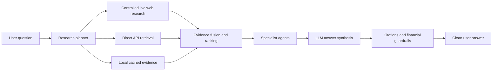

# Milestone 8.1: Agent Architecture Reset

Status: Complete

## Goal

Create the Phase 8 architecture spine before implementing live web research. This milestone defines how the app should move from a one-pass local-data agent flow to a planner-driven research workflow that can later search the web, query direct APIs, use local cached data, run specialist agents, synthesize a clean answer, and enforce citations/guardrails.

## User Expectation Captured

The user wants the app to behave more like a web-capable research assistant:

- One question box should be enough for normal use.
- Web research should become the primary flexible-answer path for broad, current, local, or under-specified questions.
- APIs and local stored data should support, ground, verify, and cache findings.
- The app should make a best-effort attempt to answer instead of stopping at local missing-data messages.
- Responses should be clean and easy to digest, not raw agent traces.
- Financial guardrails must remain active.

## Architecture

## Implemented In This Milestone

- Added backend workflow schemas:
  - `ResearchWorkflowPlan`
  - `ResearchWorkflowStep`
  - `EvidenceNeed`
  - retrieval channels for `live_web`, `direct_api`, and `local_cache`
- Added a deterministic research workflow planner.
- Added initial web-first retrieval priority for current, broad, regional, or under-specified questions.
- Added source hints so direct/API and local evidence can support the web-research path.
- Updated the coordinator to reference the new research plan while keeping the existing API response shape stable.
- Added tests for:
  - live-web-first regional/current questions
  - direct API support for housing/mortgage questions
  - ordered planner steps
  - hidden debug trace by default
  - explicit source override behavior
- Updated Phase 8 docs and the implementation roadmap.

## Manual Steps

No manual setup is required for Milestone 8.1.

No new API keys are needed yet. Live web research implementation begins in later Phase 8 milestones.

## What This Does Not Implement Yet

- Actual browser/web search execution.
- Source allowlist/blocklist enforcement.
- Web result parsing and citation extraction.
- Evidence fusion runtime execution.
- Rebuilt UI.
- New prompt templates for final answer style.

## Handoff To 8.2

Milestone 8.2 should improve query understanding and turn the planner into a richer research-plan generator. It should infer:

- user intent
- topic and domain
- locations and regions
- companies and tickers
- sectors
- time horizon
- whether live web research is needed
- which direct APIs should verify the answer
- which specialist agents should run
