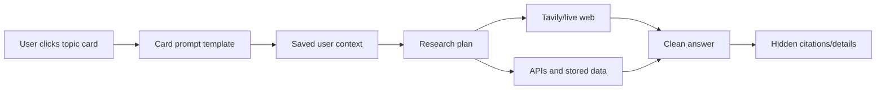

# Phase 9: UI, Prompting, And Product Experience Rebuild

Status: In Progress

## Goal

Make VerityDesk feel like a clean personal research assistant instead of a technical dashboard.

The previous phases created the data layer, connected APIs, daily automation, multi-agent workflow, and web-first research path. Phase 9 turns that foundation into a user-friendly product experience: one main chatbot, personalized topic cards, simpler settings, hidden citations, better prompts, and a calmer answer format.

## User Feedback To Address

- The current UI shows too much context, status detail, source detail, and system structure.
- The app should feel more personal and less like a dashboard.
- The user should mostly type only a question.
- The user should not need to choose agents, sources, tickers, dropdowns, or regions for normal use.
- Topic cards should automatically use saved settings such as location, watchlist, and interests.
- Citations and raw source lists should be hidden by default, but available when requested.
- The main answer should be concise, natural-language, useful, and easy to digest.
- The agents should feel invisible: the user sees an assistant, not a workflow trace.
- Tavily/live web should remain primary for freshness, while APIs and stored data corroborate and enrich.

## Timing

Phase 9 happens after Phase 8 because the app now has the live-web and multi-agent foundation needed to support the simpler experience.

This phase happens before desktop packaging and portable deployment. The goal is to make the web app experience good enough that packaging it as a Mac app in the next phase is worthwhile.

## Selected Product Direction

The selected design direction is documented in [design-options/README.md](design-options/README.md).

The chosen prototype is [Option I: Selected Neon Console](design-options/option-i-selected-neon-console.html), which combines:

- Option F's layout structure
- Option H's darker futuristic neon-terminal visual style

The implementation should follow this shape:

- left compact navigation rail
- center assistant/chat workspace
- right personalized briefing cards
- dedicated Settings page
- sources and citations hidden behind details
- dark, tech-forward, terminal-inspired visual system
- no large debug tables on the home page

## Main Chatbot Target

The chatbot is the primary product surface.

Expected behavior:

- User types a plain-language question.
- The app infers intent, location, companies, market context, time horizon, and source needs.
- The app uses Tavily/live web first for current and flexible questions.
- The app uses direct APIs and stored data as verification, context, and history.
- The app routes to only the agents needed for the question.
- The answer is a single readable response, not a list of agent outputs.
- Citations, source traces, confidence, and retrieval timestamps are available behind expandable details.
- Financial guardrails remain active, but should not overwhelm the answer.

## Personalized Card Target

Cards are one-click prebuilt questions.

They should not be hardcoded to one user or one region. They should use saved Settings context.

Examples:

- Daily Briefing: use saved interests, location, watchlist, and tracked topics.
- Local Housing Pulse: use the user's preferred location or region from Settings.
- Market Setup: use the user's market interests and risk focus.
- Watchlist Moves: use saved companies and tickers.
- World Risk Radar: use saved topics and preferred news focus.

Card click flow:

The card prompt templates will be reviewed again before Milestone 9.4 implementation.

## Citation Target

The UI should not show a large citation/source list by default.

Default answer:

- direct answer
- short supporting explanation
- what matters
- what to watch
- compact disclaimer when relevant

Expandable details:

- source links
- source types
- retrieved at timestamps
- confidence
- evidence snippets
- Tavily/API/local evidence mix

## Milestones

### 9.1 Selected UI Direction Docs

Status: Complete

- Capture the selected neon console direction.
- Document home page structure, settings structure, card behavior, citation behavior, and agent/chatbot behavior.
- Preserve the static design prototypes for reference.

Milestone doc: [milestone-9.1-selected-direction.md](milestone-9.1-selected-direction.md)

### 9.2 App Shell Redesign

Status: Complete

- Implement the real app layout:
  - left navigation rail
  - center chatbot/answer workspace
  - right briefing cards
  - dark futuristic visual system
  - responsive layout for smaller screens
- Replace the noisy dashboard-first feel with the selected console-first design.

Milestone doc: [milestone-9.2-app-shell-redesign.md](milestone-9.2-app-shell-redesign.md)

### 9.3 Settings Experience

Status: Complete

- Build the cleaned-up Settings page:
  - personal note/context
  - location/preferred regions
  - watchlist
  - tracked topics
  - source status descriptions
  - one overall refresh button
  - daily briefing/scheduler settings
- Keep source details here instead of making them prominent on the home page.

Milestone doc: [milestone-9.3-settings-experience.md](milestone-9.3-settings-experience.md)

### 9.4 Personalized Briefing Cards

Status: Complete

- Replace hardcoded cards with dynamic cards:
  - Daily Briefing
  - Local Housing Pulse
  - Market Setup
  - Watchlist Moves
  - World Risk Radar
  - optional AI/Tech or Rates/Credit based on settings
- Define card prompt templates after one more user review.
- Cards should generate prompts automatically from saved user context.

Milestone doc: [milestone-9.4-personalized-briefing-cards.md](milestone-9.4-personalized-briefing-cards.md)

### 9.5 Agent Orchestration Cleanup

Status: Complete

- Make the agents invisible to the user.
- Remove manual agent/source dropdowns from normal use.
- Route deterministically based on question/card intent.
- Avoid calling every agent or spending multiple Tavily searches unnecessarily.
- Use live web as the primary retrieval path and APIs/stored data as support.

Milestone doc: [milestone-9.5-agent-orchestration-cleanup.md](milestone-9.5-agent-orchestration-cleanup.md)

### 9.6 Prompt And Answer Format Revamp

Status: Complete

- Update prompts so answers are:
  - natural-language first
  - concise and readable
  - personalized to saved context
  - source-backed
  - clear about uncertainty
  - guarded against direct buy/sell/hold advice
- Reduce repetitive disclaimers while preserving compliance.
- Do not expose internal agent routing in the main answer.

Milestone doc: [milestone-9.6-prompt-answer-format.md](milestone-9.6-prompt-answer-format.md)

### 9.7 Hidden Citations And Evidence Drawer

Status: Planned

- Move citations/source lists out of the main answer.
- Add a View Sources or expandable details pattern.
- Show citations, retrieved timestamps, confidence, and source type only when expanded.

### 9.8 End-To-End Phase 9 Local Testing

Status: Planned

- Run the app locally and test:
  - chatbot questions
  - card-generated briefings
  - settings personalization
  - source refresh
  - Tavily/API usage
  - citation drawer
  - mobile/responsive layout
- Tune UI and prompts based on real use.

## Definition Of Done

- The first screen is simple: ask a question or click a personalized card.
- Settings holds source details, personalization, schedule, and refresh controls.
- Cards are personalized and not hardcoded to one user's location.
- Agent/source selection is automatic for normal use.
- Answers are concise, natural-language, personalized, cited, and guarded.
- Citations and source traces are hidden by default but easy to inspect.
- The product is ready to be packaged as a local desktop app in the next phase.
