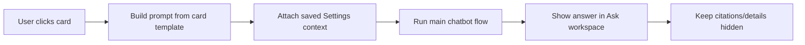

# Milestone 9.4: Personalized Briefing Cards

Status: Complete

## Purpose

Make the right-side briefing cards behave like one-click personalized questions.

The user should not need to choose agents, sources, tickers, dropdowns, or regions before using a card. The app should build a strong prompt from the card intent and saved Settings context, then run the normal chatbot flow.

## Settings Context Added

The profile can now capture more context for prompt generation:

- personal note
- preferred location
- housing markets to track
- watchlist tickers
- company names
- priority topics
- sectors to watch
- housing interests
- macro interests
- risk preference
- investing style
- preferred answer format
- topics to ignore
- briefing style and time

## Card Prompt Templates

The implemented card prompts are:

- Daily Briefing
- Local Housing Pulse
- Market Setup
- Watchlist Moves
- World Risk Radar

Each prompt includes the saved user context and asks the backend to use live web research first, then direct APIs and stored data for support and verification.

## Card Flow

## Implemented

- Added richer Settings fields for prompt personalization.
- Added prompt context generation for card actions.
- Made the Daily Briefing card use the same chatbot flow as the other cards.
- Made card clicks submit the generated prompt automatically.
- Kept cards generic and personalized at runtime.
- Kept Arizona out of card labels unless the user saves Arizona in Settings.

## Still Planned

- 9.5 will tighten backend routing and reduce unnecessary duplicate Tavily/API usage.
- 9.6 will improve the answer-generation prompts and output style.
- 9.7 will make hidden citation drawers consistent across chat, reports, and briefings.

## Validation

- Frontend typecheck passes with the local Node runtime.
- Frontend production build passes with the local Node runtime.
