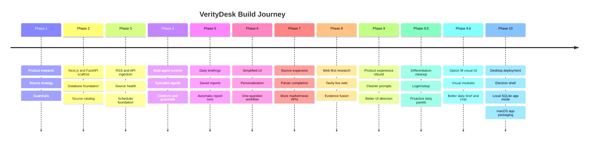

# Project History

VerityDesk was built in phases so each layer could become real before the next layer depended on it. The project started as a research/news/investing assistant idea and evolved into a local macOS desktop app with live web research, direct APIs, multi-agent synthesis, daily briefings, personalization, and local persistence.

## Build Timeline

## Phase Summary

| Phase | Status | What Changed |
| --- | --- | --- |
| Phase 1 | Complete | Defined the product, credible source strategy, investment guardrails, agent architecture, and implementation roadmap. |
| Phase 2 | Complete | Created the runnable app scaffold with Next.js, FastAPI, database models, source catalog, and first UI shell. |
| Phase 3 | Complete | Added ingestion storage, RSS/API fetchers, source scheduling, source health, and freshness visibility. |
| Phase 4 | Complete | Built the multi-agent framework with specialist agents, coordinator routing, citations, and financial guardrails. |
| Phase 5 | Complete | Added durable research outputs: daily briefings, reports, citation panels, scheduler hardening, and saved history. |
| Phase 6 | Complete | Simplified the product around personalization and one-question workflows instead of technical controls. |
| Phase 7 | Complete | Expanded and completed source connectors for Census, FHFA, Freddie Mac, Alpha Vantage, Finnhub, NewsAPI, and GDELT. |
| Phase 8 | Complete | Reworked the research system around live web first, direct APIs second, and local evidence as supporting context. |
| Phase 9 | Complete | Rebuilt the main product experience, prompts, cards, settings, and UI direction. |
| Phase 9.5 | Complete | Added product differentiation work: setup/login, daily panels, session memory, and proactive everyday-use behavior. |
| Phase 9.6 | Complete | Implemented the selected Option M visual interface, better daily briefing format, markdown chat, and visual source modules. |
| Phase 10 | Complete | Packaged the app as a local macOS desktop app with Electron, app-managed SQLite, local config, and build docs. |

## Product Evolution

### 1. From Idea To Scaffold

The first phases established the product boundaries:

- credible news and market source collection
- no direct investment recommendations
- user-facing disclaimers and guardrails
- local-first architecture
- frontend/backend split
- database-backed source catalog

### 2. From Data To Research

The middle phases connected real data and turned it into useful outputs:

- RSS and official API ingestion
- source health and freshness tracking
- article and economic observation storage
- specialist agents for news, companies, markets, macro, and housing
- saved reports and daily briefing generation

### 3. From Dashboard To Assistant

The user experience moved away from internal dashboards and toward a daily assistant:

- one natural-language chat
- hidden advanced controls
- user-specific setup and settings
- concise answers first
- citations available on demand
- daily brief cards and visual modules

### 4. From Local Dev To Desktop App

The final implementation phase made the app usable without terminal commands:

- Electron shell
- automatic backend/frontend startup
- local SQLite database mode
- Application Support config and data paths
- generated app icon
- unsigned macOS `.app` bundle

## Key Architecture Decisions

| Decision | Reason |
| --- | --- |
| Local-first desktop app before cloud hosting | Lets the product work privately on one Mac before taking on hosted auth, billing, and infrastructure. |
| Tavily-first research for flexible questions | Live web search handles current and broad questions better than relying only on stored data. |
| Direct APIs as grounding evidence | Official/provider data gives structure, numerical context, and credibility. |
| Deterministic multi-agent routing | Easier to debug than fully autonomous agent swarms while still supporting specialist analysis. |
| Hidden citations/details by default | Keeps the UI readable while preserving source transparency. |
| SQLite for desktop, Postgres for dev/future hosted path | Makes the packaged app simple while keeping a realistic multiuser database path available. |

## Current State

VerityDesk is now a working local app with:

- login and setup
- user-scoped settings and reports
- daily briefing generation
- agent chat with live web and source-backed evidence
- source health and ingestion visibility
- direct API and RSS source coverage
- visual dashboard modules
- desktop packaging for macOS

## Known Future Directions

- signed and notarized macOS distribution
- polished installer and auto-update strategy
- hosted sync across devices
- Keychain-backed secret storage
- smarter search-credit budgeting
- better long-term memory
- widgets, alerts, and notifications
- exportable reports and shareable briefings
